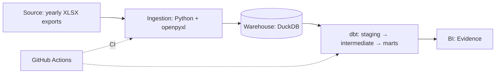

# personal-finance-analytics


> An end-to-end analytics engineering project that turns six years of household finance spreadsheets into a tested star schema and a self-serve dashboard.

🚧 **Work in progress.** Ingestion, the synthetic dataset and the dbt models are done. The dashboard is being built; see [Roadmap](#roadmap).

## Why this project

For six years, a couple tracked every transaction in yearly Google Sheets workbooks. The sheets work for data entry but can't answer cross-year questions: how fixed costs evolved, how much is still owed in installments, how the investment portfolio grew. Half of the meaning isn't even in the cells: **whose income it was** and **which card paid** are encoded as cell background colors.

This project extracts that data, colors included, into DuckDB and models it with dbt so those questions become simple queries.

## Architecture



## Synthetic data

The real workbooks hold a household's finances, so they never leave the owners' machine. The repo instead ships a generator (`synthetic/`) that writes six yearly workbooks with the same layout, so the ingestion runs on them unchanged:

- credits and debits side by side on the same sheet rows, with a different column layout in 2021
- owner and card encoded as cell colors, with the same color stored as `rgb` in some cells and as a `theme` index in others
- card purchases split into `(k/N)` installments that cross year boundaries
- a portfolio sheet that stacks one block per snapshot, repeats the whole history in every year's file and gains columns over time
- hand-typed noise: case and whitespace drift, legacy categories, blank macro-categories, stray highlight colors

Output is deterministic for a given seed, so tests and CI always see the same data.

## Data model

Star schema built by dbt in three layers: staging cleans and types the raw tables, intermediate rebuilds installment purchases, and marts hold the facts and dimensions (full design in [`docs/data-model.md`](docs/data-model.md)):

| Model | Type | Grain | Description |
| --- | --- | --- | --- |
| `fct_transactions` | Fact | One row per transaction | Credits and debits, with installment and effective-amount flags |
| `fct_installments` | Fact | One row per installment of every purchase | Full installment plans, including installments outside the workbooks' years; answers how much is still owed |
| `fct_portfolio_snapshots` | Fact | One row per asset per reference date | Investment portfolio history |
| `dim_date` | Dimension | One row per day | Generated calendar |
| `dim_category` | Dimension | One row per category | Category, macro-category (fixed / variable), type |
| `dim_owner` | Dimension | One row per owner | Derived from cell colors |
| `dim_payment_method` | Dimension | One row per payment method | Derived from cell colors |

## Data quality

- Python unit tests for every ingestion library (color resolution, installment parsing, snapshot block detection)
- End-to-end tests that generate the synthetic workbooks, run the ingestion and check what lands in DuckDB
- Bugs are pinned as strict `xfail` tests first, so the fix has to flip them to passing (see the next section)
- dbt data tests on every staging key and accepted-value set, plus source freshness on the raw tables
- dbt unit tests that pin the modeling rules (installment parsing, per-workbook theme colors, card precedence, macro-category fallback, snapshot dedup, asset aliases, installments outside the workbooks) on hand-made rows
- Relationship tests from every fact key to its dimension
- `dbt build` on every pull request, on a warehouse rebuilt from the synthetic workbooks

## Bugs the synthetic data caught

Running the ingestion end to end on the synthetic workbooks measured one suspected bug and exposed one nobody knew about:

| Bug | Root cause | Impact before the fix | Fix |
|---|---|---|---|
| Duplicate `transaction_id` | The id hashed `file\|sheet\|row`, but a credit and a debit share each sheet row | 934 of 4,142 transactions had a non-unique id | Add the side (`credit`/`debit`) to the hash |
| Portfolio totals loaded as holdings | The `Total:` filter only checked the block's first column (B); the label sits in C | 137 extra rows, doubling any per-snapshot sum | Check every label column and match the whole label, so a fund named "Total Return" still loads |

## Tech stack

| Layer | Tool | Why this choice |
| --- | --- | --- |
| Ingestion | Python + openpyxl | Reads cell fill colors, which carry business meaning (owner, card) |
| Warehouse | DuckDB | Zero-infra, file-based, runs the same locally and in CI |
| Transformation | dbt (`dbt-duckdb`) | Tested, documented, version-controlled SQL |
| BI | Evidence | Dashboards as code, versioned next to the models |
| CI | GitHub Actions | Lint, tests and `dbt build` on every pull request |

## How to run

```bash
git clone https://github.com/AllanDionizio/personal-finance-analytics.git
cd personal-finance-analytics
python -m venv .venv && source .venv/bin/activate
make setup
```

Generate the synthetic workbooks, load them into DuckDB and build the dbt project:

```bash
make data   # synthetic XLSX → data/synthetic/ → raw.* in data/warehouse.duckdb
make build  # dbt deps + dbt build (seeds, models, tests) + source freshness
```

Or both at once with `make all`.

No credentials or real data needed. The ingestion is idempotent: re-running on the same files reloads by `source_file` without duplicating rows. Unrecognized cell colors are logged with counts instead of failing the run.

## Design decisions & trade-offs

- **Decision:** English names for everything the project defines, source values left in Portuguese. **Why:** the code and models read for an international audience, while the raw layer stays a faithful copy of the workbooks (`'Sim'`, `'Mercado'`, `'Fixo'`). **Trade-off:** staging has to map the Portuguese values that drive logic, such as the paid flag and the special categories.
- **Decision:** keep the raw layer literal (installment suffixes and raw color codes untouched). **Why:** parsing rules can change and be replayed in dbt without re-reading the workbooks. **Trade-off:** the raw tables are not directly queryable for analysis.
- **Decision:** resolve both `rgb` and `theme` color references. **Why:** Google Sheets exports the same visible color either as a hex value or as a theme index, depending on how it was applied. The ingestion loads each workbook's theme palette into `raw.workbook_themes`, so dbt resolves a theme index against the file it came from. **Trade-off:** one more raw table, and theme tints are not applied (the owner colors in these workbooks have none).
- **Decision:** detect the debit-side layout from the header row instead of fixed positions. **Why:** a column was added in 2022, so 2021 workbooks have a different layout. **Trade-off:** the header detection has to be tested against both layouts.

## Roadmap

- [x] Data model design
- [x] Ingestion libraries with unit tests
- [x] Ingestion CLI: XLSX → `raw.*` in DuckDB
- [x] Repository standards: CI, pre-commit, lint
- [x] Synthetic dataset with the same structure as the real workbooks
- [x] dbt staging, with unit and data tests
- [x] dbt intermediate and marts
- [ ] dbt tests and published dbt docs
- [ ] Evidence dashboard, deployed on the synthetic data

## Repository structure

```
├── .github/workflows/   # CI
├── ingestion/           # Python extract & load
├── synthetic/           # synthetic workbook generator
├── dbt/                 # models, tests, macros, seeds
├── tests/               # Python unit tests
└── docs/                # data model design
```

---

Built by [Allan Dionizio](https://github.com/AllanDionizio) · [LinkedIn](https://www.linkedin.com/in/allandionizio/)
