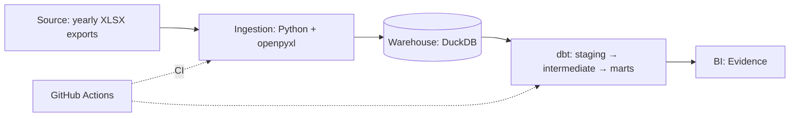
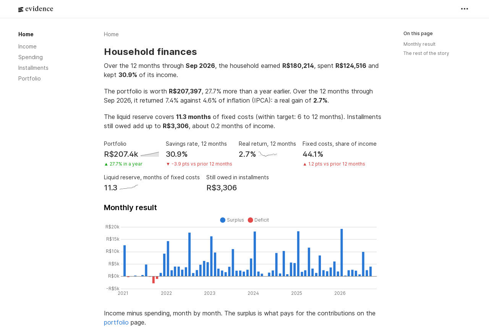

# personal-finance-analytics


> An end-to-end analytics engineering project that turns six years of household finance spreadsheets into a tested star schema and a self-serve dashboard.

**Live:** [dashboard](https://allandionizio.github.io/personal-finance-analytics/) · [dbt docs](https://allandionizio.github.io/personal-finance-analytics/dbt-docs/), both built from the synthetic data on every push to `main`.

## Why this project

For six years, a couple tracked every transaction in yearly Google Sheets workbooks. The sheets work for data entry but can't answer cross-year questions: how fixed costs evolved, how much is still owed in installments, how the investment portfolio grew. Half of the meaning isn't even in the cells: **whose income it was** and **which card paid** are encoded as cell background colors.

This project extracts that data, colors included, into DuckDB and models it with dbt so those questions become simple queries.

## Architecture



## Synthetic data

The real workbooks hold a household's finances, so they never leave the owners' machine. The repo instead ships a generator (`synthetic/`) that writes six yearly workbooks with the same layout, so the ingestion runs on them unchanged:

- credits and debits side by side on the same sheet rows, with a different column layout in 2021
- owner and card encoded as cell colors, with the same color stored as `rgb` in some cells and as a `theme` index in others
- card purchases split into `(k/N)` installments that cross year boundaries
- a portfolio sheet that stacks one block per snapshot, repeats the whole history in every year's file and gains columns over time
- hand-typed noise: case and whitespace drift, legacy categories, blank macro-categories, stray highlight colors
- a portfolio that agrees with the budget: the budget's investment rows are exactly what enters the portfolio, a maturing position is reinvested inside it, and dividends follow the fund position
- a one-off asset sale received in installments and typed on the income side, which must not count as income

Output is deterministic for a given seed, so tests and CI always see the same data.

## Data model

Star schema built by dbt in three layers: staging cleans and types the raw tables, intermediate rebuilds installment purchases, and marts hold the facts and dimensions (full design in [`docs/data-model.md`](docs/data-model.md)):

| Model | Type | Grain | Description |
| --- | --- | --- | --- |
| `fct_transactions` | Fact | One row per transaction | Credits and debits, with installment and effective-amount flags |
| `fct_installments` | Fact | One row per installment of every purchase | Full installment plans, including installments outside the workbooks' years; answers how much is still owed |
| `fct_portfolio_snapshots` | Fact | One row per asset per reference date | Investment portfolio history |
| `fct_monthly_cashflow` | Fact | One row per closed budget month | Operating income, dividends, one-off income, spending (fixed / variable), investments and savings; the dashboard's metrics, defined once |
| `fct_net_worth` | Fact | One row per portfolio snapshot | Value, contributions, modified Dietz return and inflation over the same periods (12 months and year to date), liquid reserve against its target |
| `fct_inflation_monthly` | Fact | One row per month | Official inflation (IPCA) with its price index, 12-month and year-to-date rates |
| `fct_goals` | Fact | One row | The household against its goals: financial independence (target, new money it needs, when the current pace gets there), new money and liquid reserve |
| `fct_goal_tracking` | Fact | One row per month to the independence target | Value in today's money, new money against its goal, and the projections to the target |
| `dim_date` | Dimension | One row per day | Generated calendar |
| `dim_category` | Dimension | One row per category | Category, macro-category (fixed / variable), type |
| `dim_owner` | Dimension | One row per owner | Derived from cell colors |
| `dim_payment_method` | Dimension | One row per payment method | Derived from cell colors |

## Data quality

- Python unit tests for every ingestion library (color resolution, installment parsing, snapshot block detection)
- End-to-end tests that generate the synthetic workbooks, run the ingestion and check what lands in DuckDB
- Bugs are pinned as strict `xfail` tests first, so the fix has to flip them to passing (see the next section)
- dbt data tests on every staging key and accepted-value set, plus source freshness on the raw tables
- dbt unit tests that pin the modeling rules (installment parsing, per-workbook theme colors, card precedence, macro-category fallback, snapshot dedup, asset aliases, installments outside the workbooks) on hand-made rows
- Relationship tests from every fact key to its dimension
- Reconciliation tests: every raw transaction reaches the fact with its amount, each portfolio snapshot total matches its newest source file, each installment plan adds up to its purchase, the monthly cash flow adds up to the transactions it summarizes, and every contribution and dividend lands in exactly one portfolio period
- Unit tests for the metric rules too: closed months only, asset sales outside income, the modified Dietz return (checked to fail when the formula is broken) and the 12-month requirement of the reserve
- Range and row-count checks with `dbt_expectations`, plus a custom generic test (`is_first_day_of_month`) on every `budget_month`
- Every model and source column documented, shared definitions written once as doc blocks
- `dbt build` on every pull request, on a warehouse rebuilt from the synthetic workbooks, followed by a strict dashboard build that fails on any broken query or component

## Dashboard



Five Evidence pages (`dashboards/`) over the marts, built as a static site. They read as one story, in the order a CFO would ask:

| Page | Question | Highlights |
| --- | --- | --- |
| Household finances | Is the household healthy? | A summary written from the numbers; portfolio, savings rate, real return, fixed-cost share, liquid reserve and installments owed; surplus or deficit by month |
| Income | Where does the money come from, and how stable is it? | Operating income and its real growth; income by source and by owner; dividends as a share of spending; one-off money kept apart |
| Spending | Where does it go, and what changed? | Real spending growth; the categories that moved most in a year; spending against income and inflation, indexed; fixed against variable costs |
| Installments | How much of the future is committed? | Amount still owed, in months of income; what falls due each month, past the newest workbook; open purchases |
| Portfolio | Does it grow from contributions or returns, and does it beat inflation? | Value against invested capital; return against IPCA by year and over rolling 12 months; liquid reserve against its 6–12 month band; maturity ladder; concentration; dividends |
| Goals | How far is financial independence, and what does it take? | Target, progress and the monthly new money it needs; the path to it against the current pace; new money against a goal that rises every year; liquid reserve against its target |

The metrics live in dbt (`fct_monthly_cashflow`, `fct_net_worth`, `fct_inflation_monthly`), where they are tested and documented; Evidence only reads the marts and filters them. A month counts once it is closed, so the month still being paid doesn't drag the totals down.

The look is the project's own, not Evidence's default: KPIs, charts and tables sit on cards, the type is Geist, and the site opens in dark mode with a light-mode switch. The household's own series lead in indigo and every benchmark (inflation, invested capital) is drawn in gray, so each comparison reads as "our line against the bar to beat". The palette and the gray were checked for color-vision deficiency, with separate steps for each mode, and every text color passes WCAG AA contrast on both surfaces. The theme is configuration and one stylesheet (`evidence.config.yaml`, `dashboards/components/brand.css`), so the pages keep Evidence's standard components.

## Bugs the synthetic data caught

Running the ingestion end to end on the synthetic workbooks measured one suspected bug and exposed one nobody knew about:

| Bug | Root cause | Impact before the fix | Fix |
|---|---|---|---|
| Duplicate `transaction_id` | The id hashed `file\|sheet\|row`, but a credit and a debit share each sheet row | 934 of 4,142 transactions had a non-unique id | Add the side (`credit`/`debit`) to the hash |
| Portfolio totals loaded as holdings | The `Total:` filter only checked the block's first column (B); the label sits in C | 137 extra rows, doubling any per-snapshot sum | Check every label column and match the whole label, so a fund named "Total Return" still loads |

## Tech stack

| Layer | Tool | Why this choice |
| --- | --- | --- |
| Ingestion | Python + openpyxl | Reads cell fill colors, which carry business meaning (owner, card) |
| Warehouse | DuckDB | Zero-infra, file-based, runs the same locally and in CI |
| Transformation | dbt (`dbt-duckdb`) | Tested, documented, version-controlled SQL |
| BI | Evidence | Dashboards as code (SQL + Markdown), versioned next to the models, built to a static site |
| CI / CD | GitHub Actions, GitHub Pages | Lint, tests, `dbt build` and the dashboard build on every pull request; on `main`, the same build is published to Pages |

## How to run

```bash
git clone https://github.com/AllanDionizio/personal-finance-analytics.git
cd personal-finance-analytics
python -m venv .venv && source .venv/bin/activate
make setup
```

Generate the synthetic workbooks, load them into DuckDB, build the dbt project and the dashboard:

```bash
make data       # synthetic XLSX → data/synthetic/ → raw.* in data/warehouse.duckdb
make build      # dbt deps + dbt build (seeds, models, tests) + source freshness
make dashboard  # npm ci + Evidence sources + static site in dashboards/build/
```

Or all three with `make all`. The dashboard needs Node.js 18 or newer; `make dashboard-dev` serves it with live reload instead, under `/personal-finance-analytics/` like the published site. `make site` assembles exactly what GitHub Pages serves: the dashboard at the root and the dbt docs under `dbt-docs/`.

No credentials or real data needed. The ingestion is idempotent: re-running on the same files reloads by `source_file` without duplicating rows. Unrecognized cell colors are logged with counts instead of failing the run.

### Personal mode: real workbooks, in Portuguese

The same code runs on the real workbooks, on one machine only. The XLSX files go in `data/raw/` and the warehouse in `data/real.duckdb`; both are gitignored. An optional `.env.real` file (copy `.env.real.example`) maps the placeholders (Person A, Card B) to the labels the dashboard should show and holds the household's own goals.

```bash
make real            # data/raw → data/real.duckdb, dbt build with .env.real, new money from savings
make real-dashboard  # the Portuguese dashboard on that warehouse, at 127.0.0.1
```

The Portuguese pages live in `dashboards/pt/`, laid over a copy of the project by `make dashboard-pt` (on the synthetic warehouse by default). They translate the English pages one to one, so a change to a page goes in both. Evidence formats numbers and chart months the Excel way, in English, so separators stay `1,234.5` in either language. Never run `make site` in personal mode: the published site is built from synthetic data only.

## Design decisions & trade-offs

- **Decision:** English names for everything the project defines, source values left in Portuguese. **Why:** the code and models read for an international audience, while the raw layer stays a faithful copy of the workbooks (`'Sim'`, `'Mercado'`, `'Fixo'`). **Trade-off:** staging has to map the Portuguese values that drive logic, such as the paid flag and the special categories.
- **Decision:** keep the raw layer literal (installment suffixes and raw color codes untouched). **Why:** parsing rules can change and be replayed in dbt without re-reading the workbooks. **Trade-off:** the raw tables are not directly queryable for analysis.
- **Decision:** resolve both `rgb` and `theme` color references. **Why:** Google Sheets exports the same visible color either as a hex value or as a theme index, depending on how it was applied. The ingestion loads each workbook's theme palette into `raw.workbook_themes`, so dbt resolves a theme index against the file it came from. **Trade-off:** one more raw table, and theme tints are not applied (the owner colors in these workbooks have none).
- **Decision:** keep money from selling an asset (the `'Investimentos'` income category) out of income, as non-operating income. **Why:** it is real cash in but doesn't repeat; counted as income, it would inflate the savings rate of the year it lands in. **Trade-off:** the split lives in a seed (`income_groups`) that has to follow how the categories are used.
- **Decision:** measure the portfolio's return with the modified Dietz method, taking the household's new money as the only external flow and counting dividends as return. New money is the recorded contributions by default; a var switches it to the month's savings for workbooks that also book reinvested redemptions as contributions, as the real ones do. **Why:** the workbooks record contributions but not withdrawals (a maturing asset is reinvested inside the portfolio), and Dietz handles flows in the middle of a period without daily valuations. **Trade-off:** with contributions, a withdrawal to spend that isn't recorded understates that period's return; with savings, the newest period waits for its month to close, and money that never reaches the tracked accounts reads as a loss.
- **Decision:** official inflation (IPCA) as a versioned seed from the Central Bank's public API, compounded over the same periods as the return. **Why:** the build stays reproducible and offline, and "did we beat inflation?" compares like with like. **Trade-off:** the seed is refreshed by hand when a new month is published.
- **Decision:** define the dashboard's metrics in a dbt mart (`fct_monthly_cashflow`) and keep the Evidence queries to selects and filters. **Why:** income, spending and savings get one tested, documented definition, and any other tool reading the warehouse adds them up the same way. **Trade-off:** a new metric means a dbt change, not only a dashboard edit.
- **Decision:** open-source Evidence (`@evidence-dev/evidence`) built to a static site. **Why:** it deploys anywhere static files go, with no account or server, and builds in CI on the same synthetic warehouse. **Trade-off:** Evidence's project template now points to its hosted product, Evidence Studio, which has a different syntax; moving there later would mean rewriting the pages.
- **Decision:** brand the dashboard through Evidence's theme tokens, a project Tailwind preset and one global stylesheet, instead of custom components. **Why:** the pages keep using the standard BigValue, chart and table components, and the cards come from the theme (charts are painted with the card color). **Trade-off:** a few selectors target Evidence's markup (the KPI and sidebar classes), so an Evidence upgrade can need a CSS touch-up; the strict build and the screenshots catch it.
- **Decision:** publish from the CI job that tested the build, not from a separate workflow. **Why:** the site on Pages is byte for byte what passed `dbt build` and the strict dashboard build; a failing test means nothing is deployed. **Trade-off:** a push to `main` waits for the whole pipeline before the site updates.
- **Decision:** detect the debit-side layout from the header row instead of fixed positions. **Why:** a column was added in 2022, so 2021 workbooks have a different layout. **Trade-off:** the header detection has to be tested against both layouts.

## Roadmap

- [x] Data model design
- [x] Ingestion libraries with unit tests
- [x] Ingestion CLI: XLSX → `raw.*` in DuckDB
- [x] Repository standards: CI, pre-commit, lint
- [x] Synthetic dataset with the same structure as the real workbooks
- [x] dbt staging, with unit and data tests
- [x] dbt intermediate and marts
- [x] dbt tests and column docs
- [x] Evidence dashboard on the synthetic data, built in CI
- [x] Dashboard and dbt docs published on GitHub Pages

## Repository structure

```
├── .github/workflows/   # CI
├── ingestion/           # Python extract & load
├── synthetic/           # synthetic workbook generator
├── dbt/                 # models, tests, macros, seeds
├── dashboards/          # Evidence pages and source queries
├── tests/               # Python unit tests
└── docs/                # data model design
```

---

Built by [Allan Dionizio](https://github.com/AllanDionizio) · [LinkedIn](https://www.linkedin.com/in/allandionizio/)
